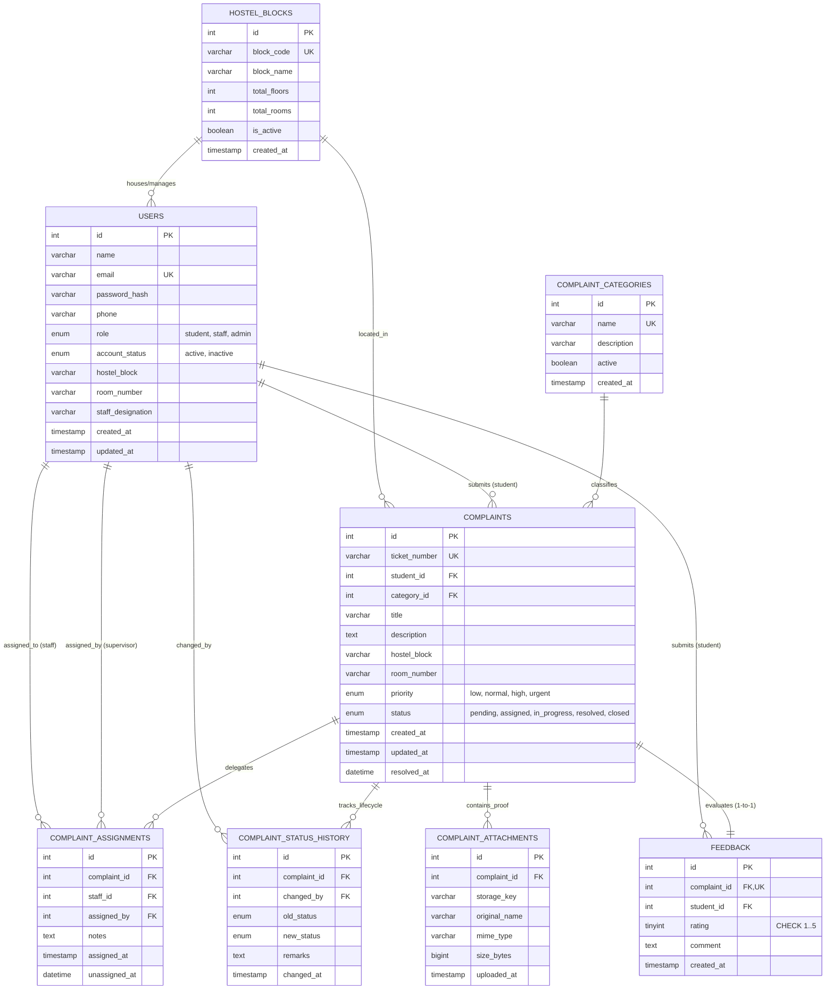

# HostelCare — Relational Database Schema & Data Dictionary

## 1. Entity-Relationship Overview

---

## 2. Table Specifications & Constraints

### 2.1 Table: `hostel_blocks` (Optional / Architectural Master)
Physical hostel blocks / residence halls on campus.
- **`id`**: `INT AUTO_INCREMENT PRIMARY KEY`
- **`block_code`**: `VARCHAR(20) NOT NULL UNIQUE` (e.g. `BLK-A`)
- **`block_name`**: `VARCHAR(100) NOT NULL` (e.g. `Block A (North Wing)`)
- **`total_floors`**: `INT NOT NULL DEFAULT 4`
- **`total_rooms`**: `INT NOT NULL DEFAULT 40`
- **`is_active`**: `BOOLEAN NOT NULL DEFAULT TRUE`

### 2.2 Table: `users`
Central user identity storage supporting role-based access control.
- **`id`**: `INT AUTO_INCREMENT PRIMARY KEY`
- **`email`**: `VARCHAR(150) NOT NULL UNIQUE`
- **`role`**: `ENUM('student', 'staff', 'admin') NOT NULL`
- **`account_status`**: `ENUM('active', 'inactive') NOT NULL DEFAULT 'active'`
- **Indexes**: `idx_users_role`, `idx_users_status`, `idx_users_block_room`

### 2.3 Table: `complaint_categories`
Classification master defining maintenance disciplines.
- **`id`**: `INT AUTO_INCREMENT PRIMARY KEY`
- **`name`**: `VARCHAR(100) NOT NULL UNIQUE` (Electrical, Plumbing, Water Supply, Cleaning, Room Repair, Other Maintenance)
- **`active`**: `BOOLEAN NOT NULL DEFAULT TRUE`

### 2.4 Table: `complaints`
Primary operational ticket entity.
- **`ticket_number`**: `VARCHAR(40) NOT NULL UNIQUE` (`HC-YYYYMMDD-XXXX`)
- **`priority`**: `ENUM('low', 'normal', 'high', 'urgent') NOT NULL DEFAULT 'normal'`
- **`status`**: `ENUM('pending', 'assigned', 'in_progress', 'resolved', 'closed') NOT NULL DEFAULT 'pending'`
- **Foreign Keys**:
  - `fk_complaint_student`: `student_id -> users(id)` (`ON DELETE RESTRICT ON UPDATE CASCADE`)
  - `fk_complaint_category`: `category_id -> complaint_categories(id)` (`ON DELETE RESTRICT ON UPDATE CASCADE`)
- **Indexes**: `idx_complaints_status`, `idx_complaints_student`, `idx_complaints_category`, `idx_complaints_priority`, `idx_complaints_created`

### 2.5 Table: `complaint_assignments`
Tracks technician delegation and work assignment history.
- **`complaint_id`**: FK $\rightarrow$ `complaints(id)` (`ON DELETE CASCADE`)
- **`staff_id`**: FK $\rightarrow$ `users(id)` (technician)
- **`assigned_by`**: FK $\rightarrow$ `users(id)` (supervisor or administrator)
- **`unassigned_at`**: `DATETIME NULL` (permits reassignments without record deletion)

### 2.6 Table: `complaint_status_history`
Immutable state transition ledger.
- **`old_status`**, **`new_status`**: Strict `ENUM` lifecycle states.
- **`changed_by`**: FK $\rightarrow$ `users(id)`
- **`remarks`**: Mandatory audit justification when resolving or reopening.

### 2.7 Table: `complaint_attachments`
Photo evidence records with file size, MIME-type, and storage key.
- **`complaint_id`**: FK $\rightarrow$ `complaints(id)` (`ON DELETE CASCADE`)
- **`storage_key`**: Sanitized server-side relative path.

### 2.8 Table: `feedback`
Post-resolution student satisfaction rating.
- **`complaint_id`**: FK $\rightarrow$ `complaints(id)` (`UNIQUE`, enforces 1 feedback per complaint).
- **`rating`**: `TINYINT NOT NULL` with `CHECK (rating BETWEEN 1 AND 5)`.

